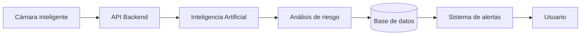
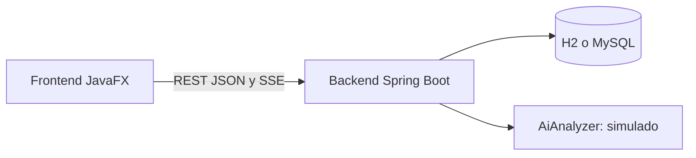

# Arquitectura y flujo del sistema

La aplicación estará desarrollada siguiendo una **arquitectura de software por capas**, donde cada componente tendrá una responsabilidad específica. El frontend permitirá visualizar el estado de las piscinas y cámaras, consultar las alertas y revisar el historial de incidentes. El backend funcionará como intermediario entre la aplicación, la inteligencia artificial, la base de datos, las cámaras y los diferentes servicios externos.

La comunicación entre los diferentes componentes se realizará mediante **APIs**, permitiendo integrar el sistema de inteligencia artificial, los servicios de notificaciones, la base de datos y otros servicios necesarios para el funcionamiento de la aplicación.

## Flujo principal del sistema

**Cámara inteligente → API Backend → Inteligencia Artificial → Análisis de riesgo → Base de datos → Sistema de alertas → Usuario**

Cuando una cámara detecte una situación, la información será enviada al backend mediante una API. El backend enviará los datos necesarios al servicio de inteligencia artificial para realizar el análisis. Si la IA determina que existe una situación potencialmente peligrosa, el sistema registrará el incidente y generará una alerta para el usuario.

## Despliegue en la nube

La aplicación será **desplegada en la nube**, permitiendo acceder al sistema desde diferentes dispositivos y demostrando el funcionamiento de una arquitectura moderna basada en servicios, APIs e inteligencia artificial.

## Patrones de diseño

Además, debido a que el proyecto pertenece a una materia relacionada con **patrones de diseño**, se implementarán diferentes patrones de software para organizar la comunicación entre los componentes y facilitar que el sistema sea escalable, mantenible y flexible. Consulta la página [Patrones de diseño](Patrones-de-Diseno).

## Arquitectura implementada actualmente

| Capa | Responsabilidad |
|---|---|
| **Frontend** (`frontend/`) | Pantallas, animaciones y notificaciones. Obtiene los datos de un `DataService`: `RestDataService` (backend) o `MockDataService` (datos de demo). |
| **Controller** (`backend/.../controller`) | Recibe las peticiones HTTP y devuelve JSON. |
| **Service** (`backend/.../service`) | Reglas de negocio: transiciones de estado de las alertas, análisis de IA, estadísticas y alertas en tiempo real. |
| **Repository** (`backend/.../repository`) | Acceso a la base de datos con Spring Data JPA. |
| **Model** (`backend/.../model`) | Entidades y tipos del dominio. |
| **Base de datos** | Guarda piscinas, cámaras, usuarios, alertas e incidentes. |

El frontend no accede directamente a la base de datos: siempre pasa por el backend. Si el backend no está disponible, el frontend abre con datos de demostración.

## Alertas en tiempo real

Cuando se crea una alerta crítica, el backend publica un evento interno y lo envía a los clientes conectados mediante **Server-Sent Events** (`GET /api/alerts/stream`). El frontend muestra entonces el aviso rojo y la notificación sin recargar.

---
[⬅ Volver al inicio](Home)
