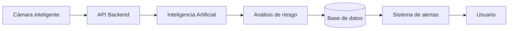
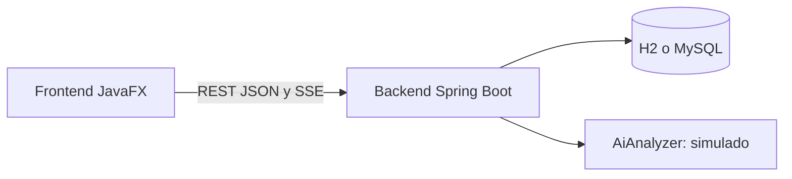

# Smart Pool Security · Cámaras Inteligentes para Piscinas

Aplicación para **apoyar la seguridad en piscinas** mediante cámaras inteligentes e inteligencia artificial. Detecta posibles situaciones de riesgo —especialmente posibles casos de ahogamiento— y genera alertas para que el personal pueda intervenir rápidamente.

> ⚠️ **Prototipo universitario.** La IA y las cámaras están **simuladas**. El sistema es una herramienta de apoyo; **no reemplaza** al salvavidas ni al personal de seguridad.

## Flujo principal



## Arquitectura



| Parte | Tecnología |
|---|---|
| Frontend | Java 17+, JavaFX 21, Gson |
| Backend | Java 17+, Spring Boot 3.2, Spring Web, Spring Data JPA, Validation |
| Base de datos | H2 en archivo (por defecto) o MySQL |
| Construcción | Maven |

## Estructura del repositorio

```
smart-pool-security/
├── frontend/   Aplicación de escritorio JavaFX
├── backend/    API REST con Spring Boot
├── docs/       Documento original del proyecto
└── README.md
```

## Inicio rápido

Necesitas **JDK 17 o superior** e **IntelliJ IDEA Community**.

1. **Backend primero:** abre `backend/pom.xml` en IntelliJ y ejecuta `SmartPoolApplication`. Espera `Started SmartPoolApplication`.
2. **Frontend:** abre `frontend/pom.xml` en otra ventana y ejecuta **Maven → Plugins → javafx → javafx:run**.

El encabezado debe decir **"Connected to backend"**. Si dice "Demo mode", el backend no estaba encendido y la aplicación usa datos de demostración.

Guía completa, con MySQL y solución de problemas: [Guía de instalación](../../wiki/Guia-de-Instalacion).

## Qué incluye

- Dashboard con piscinas, cámaras, alertas e incidentes críticos
- Monitoreo de piscinas y de cámaras, con vista de cámara simulada y panel de IA
- Alertas con Confirm, Attend y Close, y aviso rojo en tiempo real para las críticas
- Historial de incidentes con filtros, detalle y observaciones
- Estadísticas, gestión de usuarios y notificaciones animadas
- Backend REST con base de datos persistente

## Patrones de diseño

Singleton, Observer, Strategy, Factory, Adapter y Repository. Dónde y para qué: [Patrones de diseño](../../wiki/Patrones-de-Diseno).

## Documentación

Toda la documentación está en la **[Wiki](../../wiki)**:

- [Descripción del proyecto](../../wiki/Descripcion-del-Proyecto) y [arquitectura](../../wiki/Arquitectura-y-Flujo)
- [Requerimientos funcionales](../../wiki/Requerimientos-Funcionales) y [no funcionales](../../wiki/Requerimientos-No-Funcionales)
- [Estado de implementación](../../wiki/Estado-de-Implementacion)
- [API REST](../../wiki/API-REST) y [base de datos](../../wiki/Base-de-Datos)
- [Hoja de ruta](../../wiki/Hoja-de-Ruta)

## Autores

_Agrega aquí los nombres del equipo, la materia y la universidad._
